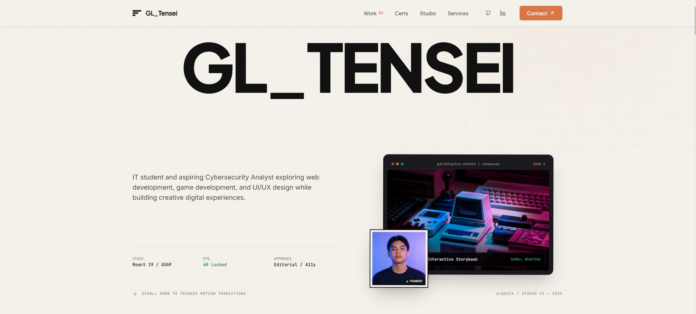

# GL_Tensei — Creative Developer & Cybersecurity Portfolio

<div align="center">
  

  <p align="center">
    <strong>Gary Luis Alquiza</strong> • BSIT Student & Aspiring Cybersecurity Analyst  
    <em>Digos City, Davao del Sur, Philippines</em>
  </p>

  <p align="center">
    <a href="https://github.com/glquiza/portfolio"></a>
    <a href="https://linkedin.com"></a>
    
    
    
    
  </p>
</div>

---

## 📖 Overview

A responsive, editorial developer portfolio and technical showcase engineered with **React 19**, **GSAP**, and **Tailwind CSS**. Crafted with a tactile warm-parchment aesthetic, interactive micro-physics, embedded playable mini-projects, and verified academic & cybersecurity credentials.

---

## ⚡ Interactive Mini-Projects

The portfolio features three playable, fully interactive engineering labs embedded directly inside the case study inspector:

1. **CyberThreat Matrix (Threat Radar & Defense Console)**
   - Sweeping 360° radar canvas with reactive threat telemetry nodes (`Critical`, `Elevated`, `Guarded`).
   - Active countermeasure pulse wave animation and real-time incident audit terminal log.
   - Built with HTML5 Canvas, Web Audio alerts, and GSAP motion.

2. **PixelForge: 2D Physics Lab**
   - Interactive 2D kinetic physics sandbox with velocity conservation, momentum transfer, and boundary restitution.
   - Real-time environment switches (**Earth**, **Moon**, **Zero-G**, **Invert**), drag-to-throw velocity vectors, and CRT scanlines.
   - Synthesized Web Audio collision beeps with retro sound effects.

3. **RiffWave: Kinetic Audio Studio**
   - Tactile polyphonic Web Audio synthesizer featuring custom guitar power chords and ambient lead pads.
   - Reactive SVG waveform visualizer driven by GSAP Bezier morphing and real-time BPM tempo engine.
   - Automated arpeggiator sequencer and acoustic resonance controls.

---

## 📜 Verified Certifications & Credentials

The **Certifications** hub houses verified industry qualifications with interactive category filters (`ALL`, `CYBERSECURITY`, `NETWORKING`, `WEB & DEV`, `PROFESSIONAL`):

- **Ignite Lite – Entrepreneurship & Tech Ideation (Featured)**  
  *Issuer:* Wadhwani Foundation & Cor Jesu College, Incorporated  
  *Credential ID:* `6a617733bf2abf176586bb60` (24 Hours of Coursework Training)  
  *Features:* High-resolution interactive lightbox preview, one-click credential ID copy, and official PDF download/verification.
- **Google Cybersecurity Professional Certificate** — Coursera / Google
- **Cisco Networking & Endpoint Defense** — Cisco Networking Academy
- **DICT Philippine Cybersecurity Awareness** — Department of Information and Communications Technology
- **ISC² Certified in Cybersecurity (CC) Candidate** — ISC² International
- **Meta Front-End Development Specialization** — Meta / Coursera

---

## 🎨 Design & Experience Features

- **Editorial Warm-Parchment Palette:** Natural tones (`#F4F0EA`, terracotta `#D97746`, obsidian `#111111`) inspired by high-end design studios.
- **GSAP ScrollTrigger Choreography:** Butter-smooth entrance reveals, pinned horizontal tickers, and layered section transitions.
- **Fluid Magnetic Cursor:** Physics-lerped orange cursor follower orbiting title typography.
- **Tactile Project Inspector Modal:** Toggle between case specs and live interactive mini-apps with zero page reload.
- **Fully Responsive & Accessible:** Fluid scaling across ultra-wide monitors, laptops, tablets, and mobile devices.

---

## 🛠️ Tech Stack

| Category | Technology |
|---|---|
| **Frontend Framework** | [React 19](https://react.dev/) + [Vite](https://vitejs.dev/) |
| **Motion & Animation** | [GSAP](https://gsap.com/) (ScrollTrigger, Flip, Ticker) & [@gsap/react](https://www.npmjs.com/package/@gsap/react) |
| **Styling** | [Tailwind CSS](https://tailwindcss.com/) + Custom Design Tokens |
| **Audio Synthesis** | Native [Web Audio API](https://developer.mozilla.org/en-US/docs/Web/API/Web_Audio_API) (Polyphonic Oscillators & Gain Nodes) |
| **Graphics & Physics** | HTML5 2D Canvas + Verlet/Euler Kinematics |
| **Icons & Typography** | [Lucide React](https://lucide.dev/) + Inter Display & JetBrains Mono |
| **Version Control** | Git & [GitHub](https://github.com/glquiza/portfolio) |

---

## 📂 Project Structure

```text
ALQUIZA PORTFOLIO/
├── public/
│   ├── Screenshot.png                  # Showcase portfolio preview
│   ├── certificates/                   # Verified credentials & high-res previews
│   │   ├── wadhwani-foundation-preview.png
│   │   ├── wadhwani-foundation-certificate.pdf
│   │   └── Wadhwani Foundation Certificate - 6a617733bf2abf176586bb60.pdf
│   └── images/                         # Project images & assets (1.png - 9.png)
├── src/
│   ├── components/
│   │   ├── miniprojects/               # Interactive standalone mini-apps
│   │   │   ├── CyberThreatMatrix.jsx   # Radar defense console
│   │   │   ├── RetroPhysicsLab.jsx     # 2D physics sandbox
│   │   │   └── KineticAudioStudio.jsx  # Web Audio synthesizer
│   │   ├── Certifications.jsx          # Credentials grid & lightbox viewer
│   │   ├── ProjectInspectorModal.jsx   # Interactive demo & case specs modal
│   │   ├── ProjectCard.jsx             # Project card with "Play demo" triggers
│   │   ├── InteractiveBackground.jsx   # Ambient interactive motion backdrop
│   │   ├── LoadingScreen.jsx           # Editorial curtain loader
│   │   ├── Navbar.jsx                  # Sticky navigation & smooth anchor jump
│   │   ├── Hero.jsx                    # Editorial title & dynamic cursor follower
│   │   ├── Marquee.jsx                 # Infinite typographic ticker
│   │   ├── Projects.jsx                # Selected works showcase
│   │   ├── Services.jsx                # Core competencies & capabilities
│   │   ├── About.jsx                   # Studio philosophy & tech stack
│   │   ├── Contact.jsx                 # Direct outreach channel
│   │   └── Footer.jsx                  # Studio colophon & live status
│   ├── data/
│   │   └── projectsData.js             # Data source of truth for projects & certs
│   ├── pages/
│   │   └── Home.jsx                    # Composed root view
│   ├── App.jsx                         # Application router
│   ├── index.css                       # Global styles & Tailwind utilities
│   └── main.jsx                        # React root entry
├── package.json
└── README.md
```

---

## 🚀 Getting Started

### Prerequisites

- [Node.js](https://nodejs.org/) (version 18+ recommended)
- `npm` or `pnpm`

### Installation

1. **Clone the repository:**
   ```bash
   git clone https://github.com/glquiza/portfolio.git
   cd portfolio
   ```

2. **Install dependencies:**
   ```bash
   npm install
   ```

3. **Start the local development server:**
   ```bash
   npm run dev
   ```
   Open [http://localhost:5173](http://localhost:5173) in your browser.

### Production Build

```bash
# Build optimized production bundle into /dist
npm run build

# Preview production build locally
npm run preview
```

---

## 👤 Author

**Gary Luis Alquiza (`GL_Tensei`)**  
- GitHub: [@glquiza](https://github.com/glquiza)  
- Focus: Cybersecurity Analysis, Web Architecture, Game Development & Motion Design  
- Institution: Cor Jesu College, Incorporated (Digos City, Davao del Sur, Philippines)

---

## 📄 License

This project is licensed under the [MIT License](LICENSE).
